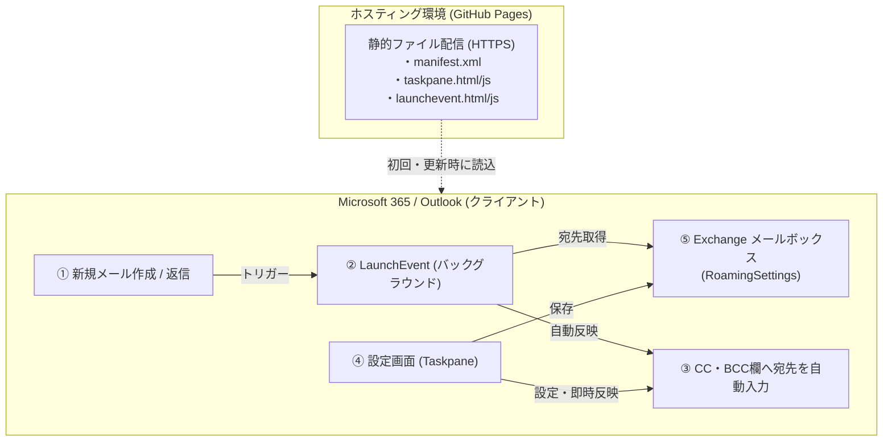

# 【仕様書】Outlook New 自動CC・BCC挿入アドイン

| 項目 | 内容 |
| :--- | :--- |
| **システム名称** | Outlook New 自動CC・BCC挿入アドイン (Auto CC/BCC Add-in) |
| **作成日** | 2026年11月19日 |
| **バージョン** | 1.0.0 |
| **対応環境** | 新しいOutlook (New Outlook for Windows), Outlook on the web |
| **対象ユーザー** | Microsoft 365 (Exchange Online) を利用する全社・部門ユーザー |

---

## 1. 開発背景と目的

### 1.1 背景
従来のOutlook（クラシック版）で利用されていたVBAマクロやCOMアドインは、Microsoftの次世代クライアントである「**新しいOutlook (New Outlook)**」および「**Web版Outlook**」ではセキュリティおよびクロスプラットフォーム仕様により動作しません。

### 1.2 目的
- **入力漏れ・確認漏れの撲滅**: 業務上必須となる管理者・共有アドレス（監査用、案件管理用等）へのCC/BCC入れ忘れを未然に防止。
- **誤送信防止・ガバナンス強化**: 宛先指定を自動化することでヒューマンエラーを低減。
- **業務工数の削減**: 毎回のメール新規作成・返信時におけるアドレス手入力作業をゼロ化。

---

## 2. システム概要・アーキテクチャ

本アドインは、Microsoftが公式に推奨する **Office JavaScript API (Web Add-in)** の標準仕様に準拠して開発されています。

### 2.1 技術スタック
- **アドイン種別**: Office Web Add-in (Outlook Mailbox Add-in)
- **API要件**: Mailbox API 1.10 以上 (Event-based activation サポート)
- **フロントエンド技術**: HTML5, CSS3, JavaScript (ES6 / Office.js)
- **ホスティング方式**: 静的Webホスティング (GitHub Pages / 常時HTTPS)

---

## 3. 主要機能一覧

| No | 機能名 | トリガー | 概要 |
| :---: | :--- | :--- | :--- |
| **1** | **新規作成時自動入力** | メール新規作成 / 返信 / 転送 | メール編集画面が開かれた瞬間にバックグラウンドで起動し、事前登録されたCC/BCCアドレスを自動追加。 |
| **2** | **設定画面 (Taskpane)** | リボンメニュー「CC/BCC設定」 | ユーザーが自身で追加したいCCおよびBCCのアドレスを設定・変更可能。 |
| **3** | **設定保存＆即時適用** | 設定画面のボタン押下 | 設定を保存すると同時に、現在画面で開いている編集中のメールにもその場でCC/BCCを反映。 |
| **4** | **現在メールへの即時挿入** | 設定画面のボタン押下 | 保存されているアドレスを、現在開いているメールへワンクリックで手動挿入。 |
| **5** | **複数アドレス対応** | 設定入力時 | セミコロン（`;`）またはカンマ（`,`）区切りで複数のメールアドレスを登録可能。 |
| **6** | **有効/無効切り替え** | 設定画面のチェックボックス | 一時的に自動入力を停止したい場合に、ワンクリックで機能のON/OFFが可能。 |
| **7** | **アカウント間設定同期** | 設定保存時 | 設定情報はユーザーのExchangeアカウントに紐付いて保存されるため、PC移行時やWeb版でも同一設定が自動適用。 |

---

## 4. セキュリティおよびデータプライバシー

本ツールは企業のセキュリティポリシーに配慮し、以下のような安全設計を採用しています。

> [!IMPORTANT]
> **外部への情報漏洩リスク：なし（完全ゼロ）**
> - 本アドインは、メール本文、宛先、件名、添付ファイル等のデータを**外部サーバーへ送信・中継する処理を一切含みません**。
> - すべての宛先解決および入力処理は、端末ローカル（Outlookブラウザランタイム内）で完結します。

### 4.1 要求権限
- **権限レベル**: `ReadWriteItem`
- **利用目的**: 作成中のメールアイテムに対するCC/BCCフィールドの読み書きのみに限定。受信トレイ全体の走査やメールボックスの管理権限等は要求しません。

### 4.2 設定データの保存先
- **保存場所**: `Office.context.roamingSettings`（Microsoft Exchange Online のユーザー領域内）
- **通信経路**: Microsoft 365 のセキュアな内部APIを介して保存され、外部データベース等は使用しません。

### 4.3 コードの配信元
- 全通信は **TLS 1.2/1.3 (HTTPS)** で暗号化された GitHub Pages 経由で静的リソース（HTML/JS/アイコン）のみを読み込みます。

---

## 5. 運用および利用手順

### 5.1 一般ユーザーの利用方法
1. **初期設定**:
   - メール作成画面のリボンメニューにある **「CC/BCC設定」** をクリック。
   - 右側に表示される設定画面で、自動追加したいCC・BCCアドレスを入力。
   - **「設定を保存 & 現在のメールに適用」** をクリック。
2. **日常業務**:
   - 次回以降、「新しいメール」をクリックした際、自動的に設定した宛先がCC/BCC欄に入力されます。

### 5.2 組織展開（全社配布）を行う場合（管理者向け）
- 個別ユーザーによるサイドロード（手動追加）のほか、Microsoft 365 管理センター（**統合アプリ / Integrated Apps**）から本マニフェスト（`manifest.xml`）を一括登録することで、**組織内の特定グループまたは全社員のOutlookへ自動配布・強制適用**することも可能です。

---

## 6. 特記事項・フェイルセーフ仕様

- **タイムアウト保護（フリーズ防止）**:
  万が一の通信遅延やAPI応答待ちによるOutlookの動作フリーズを防止するため、バックグラウンド処理には最大4秒のタイムアウト監視（Watchdog Timer）を実装。時間内に処理が完了しない場合でもメール作成画面の操作をブロックしません。
- **重複登録防止**:
  ユーザーが誤って同一画面でボタンを複数回押下しても、メール送信時の安定性を保つフォールバック処理を組み込んでいます。
